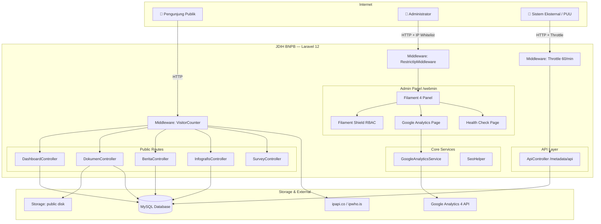

# JDIH BNPB — Jaringan Dokumentasi dan Informasi Hukum

> **Portal resmi produk hukum Badan Nasional Penanggulangan Bencana (BNPB).**
> Menyediakan akses publik terhadap peraturan perundang-undangan, monografi, artikel, dan putusan hukum yang dikelola oleh Kedeputian Bidang Hukum BNPB — dilengkapi panel administrasi berbasis peran, API metadata terbuka, dan dasbor analitik terintegrasi Google Analytics 4.

---

## Daftar Isi

- [Tentang Aplikasi](#tentang-aplikasi)
- [Fitur Utama](#fitur-utama)
- [Tech Stack](#tech-stack)
- [Arsitektur Singkat](#arsitektur-singkat)
- [Quick Start — Setup Lokal 5 Menit](#quick-start--setup-lokal-5-menit)
- [Struktur Direktori](#struktur-direktori)
- [Dokumentasi Lanjutan](#dokumentasi-lanjutan)
- [Kontribusi](#kontribusi)
- [Lisensi](#lisensi)

---

## Tentang Aplikasi

JDIH BNPB adalah sistem manajemen dan publikasi dokumen hukum yang dibangun di atas **Laravel 12** dengan antarmuka administrasi **Filament 4**. Sistem ini melayani dua kelompok pengguna utama:

| Kelompok | Akses | Deskripsi |
|---|---|---|
| **Publik** | Portal web (`/`) | Pencarian, pratinjau, dan unduhan dokumen hukum tanpa autentikasi |
| **Administrator** | Panel admin (`/webmin`) | Manajemen konten, pengguna, role, dan pemantauan sistem |

---

## Fitur Utama

### Portal Publik
- **Katalog Dokumen Hukum** — Peraturan, Monografi, Artikel, dan Putusan dengan filter multi-dimensi (jenis, tahun, bidang hukum, subjek)
- **Pratinjau PDF In-Browser** — Baca dokumen langsung tanpa mengunduh
- **Unduhan Terproteksi** — Lampiran dan abstrak hanya tersedia untuk dokumen berstatus `BERLAKU`
- **Berita & Infografis** — Konten editorial yang dikelola admin
- **Halaman Profil Dinamis** — Konten statis (Visi Misi, Struktur Organisasi, FAQ) dikelola via CMS
- **Rating Website** — Survei kepuasan pengunjung dengan distribusi bintang real-time
- **Visitor Tracking** — Pencatatan pengunjung unik harian dengan deteksi geolokasi dan bot

### Panel Administrasi (`/webmin`)
- **Manajemen Dokumen Hukum** — CRUD lengkap dengan auto-generate slug & UID (`PERKA/BNPB/01/2024`)
- **Manajemen Konten** — Berita, Infografis, Profil Page, FAQ
- **Metadata Referensi** — Jenis Dokumen, Bidang Hukum, Subjek Hukum
- **User & Role Management** — Berbasis Spatie Permission + Filament Shield
- **Google Analytics Dashboard** — Tren kunjungan, sumber traffic, perangkat, negara, browser
- **Application Health Check** — Monitoring kesehatan sistem (DB, cache, storage, queue)
- **Visitor Logs** — Log pengunjung dengan deteksi aktivitas mencurigakan

### API Publik
- **`GET /metadata/api`** — Metadata dokumen untuk sinkronisasi sistem PUU eksternal (throttle 60 req/menit)
- **`GET /api/rating-summary`** — Ringkasan rating kepuasan pengunjung

---

## Tech Stack

| Kategori | Teknologi | Versi |
|---|---|---|
| **Backend Framework** | Laravel | `^12.0` |
| **PHP** | PHP | `^8.2` |
| **Admin Panel** | Filament | `^4.0` |
| **Frontend Reaktif** | Livewire | `^3.5` |
| **CSS Framework** | Tailwind CSS | `^4.3` |
| **Build Tool** | Vite | `^8.0` |
| **Database** | MySQL | `8.0+` |
| **Authorization** | Spatie Laravel Permission | `^6.x` |
| **Admin Shield** | Filament Shield | `^4.0` |
| **Activity Log** | Spatie Laravel Activitylog | `^4.12` |
| **Health Check** | Spatie Laravel Health | `^3.x` |
| **Analytics API** | Google Analytics Data (GA4) | `^0.24` |
| **Bot Detection** | Jaybizzle Crawler Detect | `^1.3` |
| **Date/Time** | Carbon | `^3.8` |
| **Dev Tools** | Laravel Pint, IDE Helper, Pail | latest |

---

## Arsitektur Singkat



---

## Quick Start — Setup Lokal 5 Menit

### Prasyarat

Pastikan sudah terinstall di mesin Anda:

- **PHP** `>= 8.2` dengan ekstensi: `pdo_mysql`, `mbstring`, `openssl`, `tokenizer`, `xml`, `ctype`, `json`, `bcmath`, `fileinfo`
- **Composer** `>= 2.x`
- **Node.js** `>= 20.x` + **npm**
- **MySQL** `>= 8.0`

### Langkah Instalasi

```bash
# 1. Clone repository
git clone https://github.com/bnpb/jdih-bnpb.git
cd jdih-bnpb

# 2. Install dependensi PHP
composer install

# 3. Install dependensi Node.js
npm install

# 4. Salin file konfigurasi environment
cp .env.example .env

# 5. Generate application key
php artisan key:generate
```

### Konfigurasi Database

Edit file `.env` dan sesuaikan koneksi database:

```dotenv
DB_CONNECTION=mysql
DB_HOST=127.0.0.1
DB_PORT=3306
DB_DATABASE=jdih_bnpb
DB_USERNAME=root
DB_PASSWORD=
```

```bash
# 6. Buat database (jika belum ada)
mysql -u root -e "CREATE DATABASE jdih_bnpb CHARACTER SET utf8mb4 COLLATE utf8mb4_unicode_ci;"

# 7. Jalankan migrasi dan seeder
php artisan migrate --seed
```

### Setup Filament & Permission

```bash
# 8. Generate permission untuk panel admin
php artisan shield:generate --panel=webmin --all

# 9. Buat akun Super Admin (ikuti prompt interaktif)
php artisan shield:super-admin

# 10. Buat symlink storage publik
php artisan storage:link
```

### Build Frontend & Jalankan Server

```bash
# 11. Build asset frontend
npm run build

# 12. Jalankan semua service sekaligus (server + queue + log + vite)
composer run dev
```

> Atau jalankan secara terpisah:
> ```bash
> php artisan serve        # http://localhost:8000
> npm run dev              # Vite dev server
> php artisan queue:listen # Queue worker
> ```

### Verifikasi

Buka browser dan akses:

| URL | Keterangan |
|---|---|
| `http://localhost:8000` | Portal publik JDIH |
| `http://localhost:8000/webmin` | Panel administrasi |
| `http://localhost:8000/metadata/api` | Endpoint API metadata |

---

## Struktur Direktori

```
jdih-bnpb/
├── app/
│   ├── Filament/
│   │   ├── Pages/              # Custom Filament pages (GoogleAnalytics, HealthCheck)
│   │   ├── Resources/          # CRUD resources (DokumenHukum, Berita, dll)
│   │   └── Widgets/            # Dashboard widgets (Stats, Charts)
│   ├── Http/
│   │   ├── Controllers/        # Web & API controllers
│   │   ├── Middleware/         # VisitorCounter, RestrictIpMiddleware
│   │   └── Requests/           # Form Request validation
│   ├── Livewire/               # Komponen Livewire (DokumenList, DropdownDokumen)
│   ├── Models/                 # Eloquent models
│   ├── Observers/              # Model observers (slug, file cleanup)
│   ├── Providers/
│   │   └── Filament/
│   │       └── WebminPanelProvider.php
│   └── Services/
│       └── GoogleAnalyticsService.php
├── config/
│   ├── services.php            # Google Analytics config
│   └── whitelist-ip.php        # IP whitelist untuk panel admin
├── database/
│   ├── migrations/
│   └── seeders/
├── resources/
│   ├── css/filament/webmin/    # Custom Filament theme
│   └── views/
│       ├── filament/pages/     # Custom Filament blade views
│       ├── dokumen/            # View portal dokumen
│       ├── berita/             # View portal berita
│       └── layout/             # Layout utama portal publik
├── routes/
│   └── web.php
├── storage/
│   └── app/private/            # Credentials GA (TIDAK masuk git)
├── .env.example
├── AdminPanelDocs.md           # Panduan setup Filament Shield
├── APIDocs.md                  # Dokumentasi API publik
└── README.md                   # File ini
```

---

## Dokumentasi Lanjutan

| Dokumen | Deskripsi |
|---|---|
| [`docs/PRODUCT_SPEC.md`](docs/PRODUCT_SPEC.md) | Spesifikasi produk, RBAC matrix, alur bisnis |
| [`docs/ARCHITECTURE.md`](docs/ARCHITECTURE.md) | Peta arsitektur teknis, skema database, ADR |
| [`docs/CONTRIBUTING.md`](docs/CONTRIBUTING.md) | Panduan kontribusi, Git branching, Conventional Commits |
| [`docs/DEPLOYMENT.md`](docs/DEPLOYMENT.md) | Manual deployment production, checklist, troubleshooting |
| [`AdminPanelDocs.md`](AdminPanelDocs.md) | Panduan setup Filament Shield & Super Admin |
| [`APIDocs.md`](APIDocs.md) | Dokumentasi lengkap API publik `/metadata/api` |

---

## Kontribusi

Lihat [`docs/CONTRIBUTING.md`](docs/CONTRIBUTING.md) untuk panduan lengkap mengenai:
- Git branching strategy
- Conventional Commits standard
- Code style (Laravel Pint)
- Pull Request workflow

---

## Lisensi

Aplikasi ini dikembangkan untuk keperluan internal **Badan Nasional Penanggulangan Bencana (BNPB)** Republik Indonesia.
Seluruh kode sumber bersifat proprietary dan tidak untuk didistribusikan tanpa izin tertulis dari BNPB.

---

<div align="center">
  <sub>Dikembangkan oleh Tim IT Kedeputian Bidang Hukum BNPB &bull; Jakarta, Indonesia</sub>
</div>
