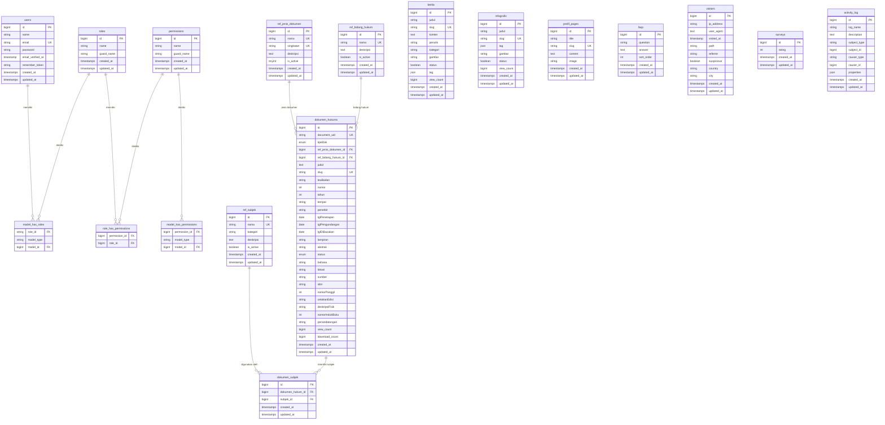
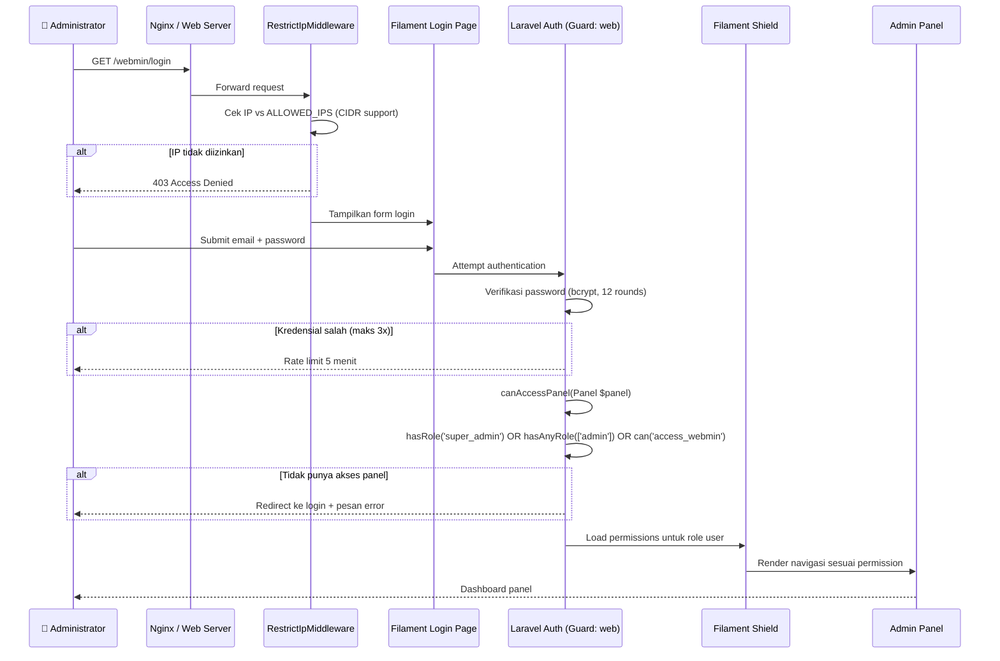
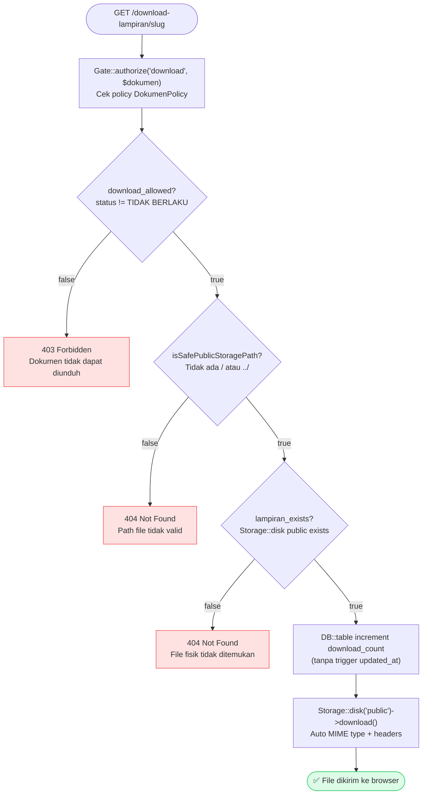

[↩ Kembali ke Beranda](../README.md)

# Arsitektur Teknis — JDIH BNPB

> **Dokumen ini ditujukan untuk:** Software Engineer, DevOps, dan Tech Lead yang perlu memahami *bagaimana* sistem ini dibangun, keputusan desain yang diambil, dan mengapa.

---

## Daftar Isi

- [Diagram Arsitektur Sistem](#diagram-arsitektur-sistem)
- [Layer Aplikasi](#layer-aplikasi)
- [Skema Database](#skema-database)
  - [Entity Relationship Diagram](#entity-relationship-diagram)
  - [Deskripsi Tabel](#deskripsi-tabel)
  - [Indeks Performa](#indeks-performa)
- [Alur Keamanan](#alur-keamanan)
  - [Autentikasi Admin Panel](#autentikasi-admin-panel)
  - [IP Whitelist & Middleware Stack](#ip-whitelist--middleware-stack)
  - [Proteksi Unduhan File](#proteksi-unduhan-file)
- [Keputusan Arsitektur (ADR)](#keputusan-arsitektur-adr)

---

## Diagram Arsitektur Sistem

Diagram berikut menggambarkan arsitektur sistem secara top-down, dari lapisan jaringan hingga penyimpanan data.

```mermaid
graph TB
    subgraph CLIENT["🌐 Client Layer"]
        BROWSER["Browser Pengunjung\n(Portal Publik)"]
        ADMIN_BROWSER["Browser Administrator\n(Panel /webmin)"]
        EXT_SYS["Sistem Eksternal\n(PUU / Integrasi API)"]
    end

    subgraph NETWORK["🔒 Network & Security Layer"]
        FIREWALL["Firewall / Reverse Proxy\n(Nginx / Apache)"]
        IP_WL["IP Whitelist\nRestrictIpMiddleware\nconfig/whitelist-ip.php"]
        THROTTLE["Rate Limiter\nthrottle:60,1\n/metadata/api"]
    end

    subgraph APP["⚙️ Application Layer — Laravel 12 (Monolith)"]
        direction TB

        subgraph MW["Middleware Pipeline"]
            MW1["EncryptCookies"]
            MW2["StartSession\n(Database Driver)"]
            MW3["VerifyCsrfToken"]
            MW4["VisitorCounter\n(Bot detect + Geo IP)"]
            MW5["Authenticate\n(Filament Guard: web)"]
        end

        subgraph PUBLIC_ROUTES["Public Routes"]
            DASH["DashboardController\nGET /"]
            DOK_LIST["Livewire: DokumenList\nGET /dokumen/{tipeDok?}"]
            DOK_DETAIL["DokumenController@show\nGET /dokumen/{tipeDok}/{slug}"]
            DOK_DL["DokumenController@unduhLampiran\nGET /download-lampiran/{slug}"]
            DOK_VIEW["DokumenController@fileView\nGET /dokumen/view/{slug}"]
            BERITA["BeritaController\nGET /berita, /berita/{slug}"]
            INFOGRAFIS["InfografisController\nGET /infografis, /infografis/{slug}"]
            SURVEY["SurveyController\nPOST /, GET /api/rating*"]
        end

        subgraph ADMIN_PANEL["Admin Panel — Filament 4"]
            PANEL_PROVIDER["WebminPanelProvider\nPath: /webmin\nGuard: web"]
            SHIELD["Filament Shield\nRBAC Granular"]
            RESOURCES["Filament Resources\nDokumen, Berita, Infografis\nFAQ, Profil, Ref*, User, Role"]
            WIDGETS["Dashboard Widgets\nExecutiveStats, Charts"]
            GA_PAGE["Custom Page\nGoogleAnalytics"]
            HEALTH_PAGE["Custom Page\nHealthCheckResults"]
        end

        subgraph API_LAYER["API Layer"]
            API_CTRL["ApiController@index\nGET /metadata/api"]
        end

        subgraph SERVICES["Services & Helpers"]
            GA_SVC["GoogleAnalyticsService\nREST Transport\nCache 5 menit"]
            SEO_HELPER["SeoHelper\nOG Meta Tags"]
            BREADCRUMB["BreadcrumbComposer\nView Composer"]
        end

        subgraph MODELS["Eloquent Models + Observers"]
            M_DOK["DokumenHukum\n+ DokumenHukumObserver\nAuto slug, UID, file cleanup"]
            M_BERITA["Berita\n+ BeritaObserver"]
            M_INFOGRAFIS["Infografis\n+ InfografisObserver"]
            M_VISITOR["Visitor"]
            M_USER["User\ncanAccessPanel()"]
        end
    end

    subgraph STORAGE["💾 Storage Layer"]
        DB[("MySQL 8.0\njdih_bnpb")]
        DISK_PUBLIC["Storage: public disk\nstorage/app/public/\n(file, abstrak, lampiran/berita)"]
        DISK_PRIVATE["Storage: private\nstorage/app/private/\n(GA credentials JSON)"]
        CACHE_DB[("Cache: Database\ncache table")]
        SESSION_DB[("Session: Database\nsessions table")]
        QUEUE_DB[("Queue: Database\njobs table")]
    end

    subgraph EXTERNAL["🔗 External Services"]
        GA4_API["Google Analytics 4\nData API (REST)"]
        IPAPI["ipapi.co\nipwho.is\n(Geo IP Lookup)"]
        HEALTH_PING["bnpb.go.id\n(Health Ping Check)"]
    end

    BROWSER -->|HTTPS| FIREWALL
    ADMIN_BROWSER -->|HTTPS| FIREWALL
    EXT_SYS -->|HTTPS| FIREWALL

    FIREWALL --> MW1 --> MW2 --> MW3 --> MW4
    MW4 --> PUBLIC_ROUTES
    MW4 --> THROTTLE --> API_LAYER

    FIREWALL --> IP_WL --> MW5 --> ADMIN_PANEL

    PUBLIC_ROUTES --> MODELS
    ADMIN_PANEL --> SHIELD --> RESOURCES
    RESOURCES --> MODELS
    GA_PAGE --> GA_SVC --> GA4_API
    HEALTH_PAGE --> HEALTH_PING
    API_LAYER --> MODELS

    MODELS --> DB
    DOK_DL & DOK_VIEW --> DISK_PUBLIC
    RESOURCES --> DISK_PUBLIC
    GA_SVC --> DISK_PRIVATE
    GA_SVC --> CACHE_DB
    MW2 --> SESSION_DB
    MW4 --> IPAPI
```



---

## Layer Aplikasi

Sistem ini adalah **monolith Laravel** dengan pemisahan tanggung jawab yang jelas antar layer:

| Layer | Komponen | Tanggung Jawab |
|---|---|---|
| **Presentation** | Blade Views, Livewire Components, Filament Resources | Render HTML, interaksi UI reaktif |
| **Routing** | `routes/web.php` | Pemetaan URL ke controller, penerapan middleware |
| **Middleware** | `VisitorCounter`, `RestrictIpMiddleware`, `Authenticate` | Cross-cutting concerns: keamanan, logging, autentikasi |
| **Controller** | `DokumenController`, `BeritaController`, `ApiController`, dll | Orkestrasi request-response, delegasi ke model/service |
| **Service** | `GoogleAnalyticsService` | Logika bisnis kompleks yang dapat diuji secara terisolasi |
| **Model** | Eloquent Models + Observers | Data access, business rules, event-driven side effects |
| **Helper** | `SeoHelper`, `BreadcrumbComposer` | Utilitas lintas fitur |
| **Storage** | MySQL, public disk, private disk | Persistensi data dan file |

---

## Skema Database

### Entity Relationship Diagram



### Deskripsi Tabel

| Tabel | Baris Estimasi | Deskripsi |
|---|---|---|
| `dokumen_hukums` | 1.000 – 10.000 | Tabel utama. Menyimpan seluruh produk hukum BNPB |
| `ref_jenis_dokumen` | < 50 | Master data jenis dokumen (UU, PP, PERKA, dll) |
| `ref_bidang_hukum` | < 100 | Master data bidang hukum (Hukum Tata Negara, dll) |
| `ref_subjek` | < 500 | Master data subjek/topik hukum |
| `dokumen_subjek` | 2.000 – 30.000 | Pivot many-to-many dokumen ↔ subjek |
| `berita` | 100 – 1.000 | Artikel berita yang dikelola admin |
| `infografis` | 50 – 500 | Konten infografis visual |
| `profil_pages` | < 20 | Halaman statis CMS (Visi Misi, Struktur Org) |
| `faqs` | < 50 | Pertanyaan yang sering diajukan |
| `visitors` | 10.000 – 1.000.000 | Log pengunjung harian (tumbuh cepat) |
| `surveys` | 100 – 10.000 | Data rating kepuasan pengunjung |
| `users` | < 50 | Akun administrator |
| `roles` | < 10 | Role RBAC (super_admin, admin, editor, viewer) |
| `permissions` | 50 – 200 | Permission granular per resource |
| `activity_log` | 10.000+ | Audit trail semua aksi di panel admin |
| `sessions` | Aktif saja | Session database driver |
| `cache` | Dinamis | Cache database driver (termasuk GA cache) |
| `jobs` | Dinamis | Queue jobs database driver |

### Indeks Performa

Indeks berikut ditambahkan via migration `2026_04_27` untuk mengoptimalkan query yang paling sering dijalankan:

| Tabel | Indeks | Kolom | Tujuan |
|---|---|---|---|
| `dokumen_hukums` | `idx_...view_count` | `view_count` | Widget "Paling Banyak Dilihat" |
| `dokumen_hukums` | `idx_...download_count` | `download_count` | Widget "Paling Banyak Diunduh" |
| `dokumen_hukums` | `idx_...tahun` | `tahun` | Filter & sort berdasarkan tahun |
| `dokumen_hukums` | `idx_...status` | `status` | Filter BERLAKU/TIDAK BERLAKU |
| `dokumen_hukums` | `idx_...status_tahun` | `status, tahun` | Composite: filter + sort gabungan |
| `dokumen_hukums` | `idx_...ref_bidang_hukum_id` | `ref_bidang_hukum_id` | JOIN ke tabel bidang hukum |
| `ref_jenis_dokumen` | `idx_is_active` | `is_active` | Filter jenis dokumen aktif |
| `dokumen_hukums` | `fk_dokhukum_jenis` | `ref_jenis_dokumen_id` | Foreign key + JOIN |
| `dokumen_hukums` | `slug` (UNIQUE) | `slug` | Route model binding |
| `dokumen_hukums` | `document_uid` (UNIQUE) | `document_uid` | Lookup UID unik |

> **Catatan:** Tabel `visitors` akan tumbuh sangat cepat di production. Pertimbangkan menambahkan indeks pada `(ip_address, visited_at)` dan menjalankan job pembersihan data lama secara berkala.

---

## Alur Keamanan

### Autentikasi Admin Panel



### IP Whitelist & Middleware Stack

Middleware diterapkan berlapis. Urutan eksekusi untuk request ke `/webmin/*`:

```mermaid
flowchart LR
    REQ([HTTP Request]) --> A

    A["1. EncryptCookies\nDekripsi cookie masuk"] -->
    B["2. AddQueuedCookiesToResponse\nTambah cookie ke response"] -->
    C["3. StartSession\nLoad session dari DB"] -->
    D["4. AuthenticateSession\nValidasi session aktif"] -->
    E["5. ShareErrorsFromSession\nBagikan error ke view"] -->
    F["6. VerifyCsrfToken\nValidasi CSRF token"] -->
    G["7. SubstituteBindings\nRoute model binding"] -->
    H["8. DisableBladeIconComponents\nOptimasi Filament"] -->
    I["9. DispatchServingFilamentEvent\nEvent Filament"] -->
    J["10. RestrictIpMiddleware\nIP Whitelist check"] -->
    K["11. Authenticate\nCek session login"] -->
    L([Panel Handler])
```



**Konfigurasi IP Whitelist** (`config/whitelist-ip.php`):

```php
// .env
ALLOWED_IPS=127.0.0.1,::1,10.220.52.0/22,192.168.1.0/24

// Mendukung:
// - Single IP  : 203.0.113.5
// - CIDR range : 10.220.52.0/22 (1022 IP)
// - Localhost  : 127.0.0.1, ::1 (selalu diizinkan)
```

### Proteksi Unduhan File

Setiap request unduhan melewati tiga lapis validasi sebelum file dikirim:



**Path Traversal Prevention** — method `isSafePublicStoragePath()`:

```php
private function isSafePublicStoragePath(?string $path): bool
{
    if (!$path) return false;

    $normalized = str_replace('\\', '/', $path);

    // Tolak path absolut (dimulai dengan /)
    // Tolak path traversal (mengandung ../)
    return !str_starts_with($normalized, '/')
        && !preg_match('/(^|\/)\.\.(\/|$)/', $normalized);
}
```

---

## Keputusan Arsitektur (ADR)

### ADR-001: Monolith Laravel vs Decoupled API + SPA

**Status:** Diterima

**Konteks:** Tim perlu memilih antara arsitektur monolith (Laravel + Blade/Livewire) atau decoupled (Laravel API + React/Vue SPA).

**Keputusan:** Memilih **monolith Laravel dengan Livewire** untuk komponen reaktif.

**Alasan:**
- Tim pengembang lebih familiar dengan ekosistem Laravel
- Kompleksitas deployment lebih rendah (satu server, satu proses)
- Filament 4 menyediakan admin panel production-ready tanpa membangun dari nol
- Livewire memungkinkan interaktivitas (filter real-time, dropdown) tanpa overhead SPA
- Tidak ada kebutuhan mobile app yang memerlukan API terpisah

**Konsekuensi:** Scaling horizontal lebih kompleks jika traffic sangat tinggi. Mitigasi: caching agresif di layer database dan query.

---

### ADR-002: Database Session & Cache vs Redis

**Status:** Diterima

**Konteks:** Memilih driver untuk session, cache, dan queue.

**Keputusan:** Menggunakan **database driver** (MySQL) untuk session, cache, dan queue.

**Alasan:**
- Infrastruktur deployment target (server BNPB) tidak selalu memiliki Redis tersedia
- Mengurangi dependensi eksternal dan kompleksitas operasional
- Traffic portal hukum tidak memerlukan throughput Redis-level
- Mudah di-inspect dan di-debug langsung via MySQL

**Konsekuensi:** Performa cache sedikit lebih lambat dibanding Redis. Jika traffic meningkat signifikan, migrasi ke Redis hanya memerlukan perubahan `CACHE_STORE=redis` dan `SESSION_DRIVER=redis` di `.env`.

---

### ADR-003: Google Analytics via REST Transport (tanpa gRPC)

**Status:** Diterima

**Konteks:** Package `google/analytics-data` secara default membutuhkan ekstensi PHP `grpc` yang tidak tersedia di server Windows (Laragon) maupun banyak server Linux shared hosting.

**Keputusan:** Menggunakan **new-style client** (`V1beta\Client\BetaAnalyticsDataClient`) dengan `'transport' => 'rest'`.

**Alasan:**
- Menghilangkan dependensi pada ekstensi `grpc` yang sulit diinstall di Windows
- REST transport tersedia out-of-the-box via `google/gax`
- Performa cukup untuk use case dashboard (bukan real-time streaming)
- Cache 5 menit mengurangi frekuensi API call

**Konsekuensi:** Latensi sedikit lebih tinggi dibanding gRPC. Tidak signifikan karena data di-cache.

---

### ADR-004: IP Whitelist untuk Panel Admin vs VPN

**Status:** Diterima

**Konteks:** Panel admin perlu dibatasi aksesnya hanya untuk jaringan internal BNPB.

**Keputusan:** Menggunakan **middleware IP whitelist** dengan dukungan CIDR notation, dikonfigurasi via environment variable `ALLOWED_IPS`.

**Alasan:**
- Lebih sederhana dari setup VPN untuk semua administrator
- Mendukung CIDR range sehingga seluruh subnet kantor bisa didaftarkan dengan satu entri
- Konfigurasi via `.env` memudahkan perubahan tanpa deploy ulang kode
- Localhost selalu diizinkan untuk kemudahan development

**Konsekuensi:** Jika administrator bekerja dari luar jaringan kantor (WFH), perlu VPN atau penambahan IP ke whitelist. Ini adalah trade-off yang disengaja untuk keamanan.

---

### ADR-005: Auto-generate Slug & UID via Model Observer

**Status:** Diterima

**Konteks:** Slug URL dan UID dokumen perlu konsisten dan unik tanpa input manual dari pengguna.

**Keputusan:** Menggunakan **`Model::boot()` events** (`creating`, `updating`) untuk auto-generate slug dan UID.

**Alasan:**
- Menjamin konsistensi format di semua jalur input (panel admin, seeder, API)
- Logika terpusat di model, tidak tersebar di controller
- Format UID (`PERKA/BNPB/01/2024`) mengikuti standar katalogisasi hukum Indonesia
- Deduplication otomatis dengan suffix counter jika UID sudah ada

**Konsekuensi:** Perubahan pada field `nomor`, `tahun`, atau `ref_jenis_dokumen_id` akan men-trigger regenerasi slug dan UID. Ini bisa memutus URL lama yang sudah di-bookmark atau di-index mesin pencari. Mitigasi: tambahkan redirect 301 jika slug berubah (belum diimplementasi).

---

### ADR-006: Visitor Tracking Hanya untuk Indonesia

**Status:** Diterima

**Konteks:** Sistem perlu mencatat statistik pengunjung yang relevan untuk pelaporan ke pimpinan BNPB.

**Keputusan:** Hanya mencatat pengunjung dari **Indonesia** (berdasarkan geolokasi IP). Pengunjung luar negeri di-skip.

**Alasan:**
- Target pengguna JDIH BNPB adalah warga negara Indonesia dan instansi pemerintah Indonesia
- Mengurangi noise dari traffic internasional (scanner, bot, peneliti asing)
- Mengurangi ukuran tabel `visitors` yang tumbuh cepat
- Geolokasi via `ipapi.co` dengan fallback ke `ipwho.is` untuk reliabilitas

**Konsekuensi:** Pengunjung Indonesia yang menggunakan VPN dengan exit node luar negeri tidak akan tercatat. Ini dianggap acceptable.
