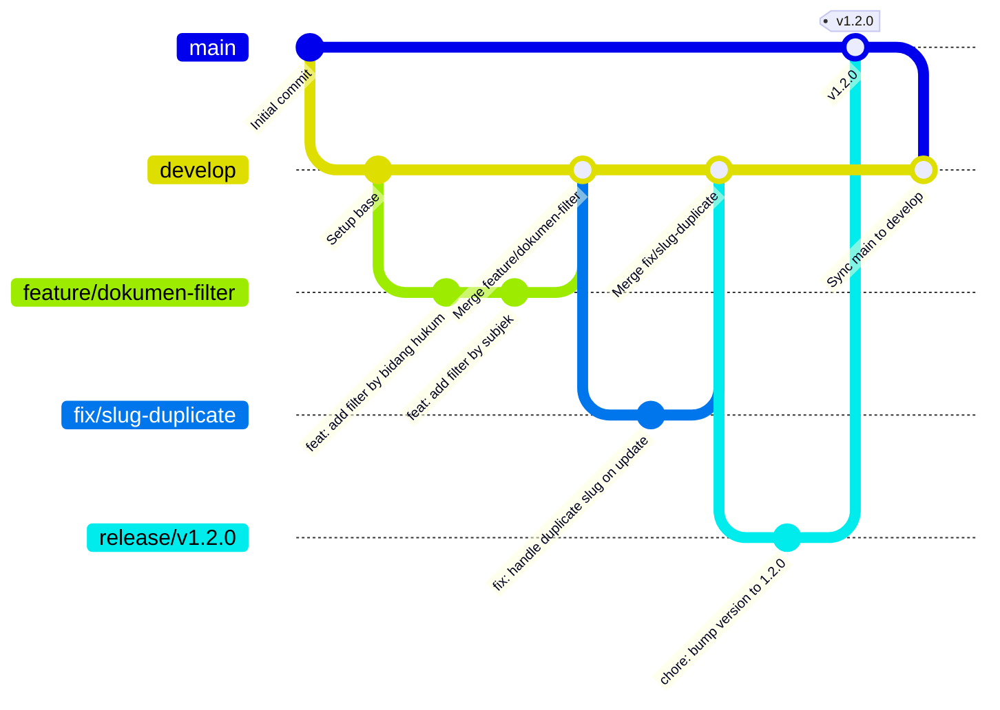
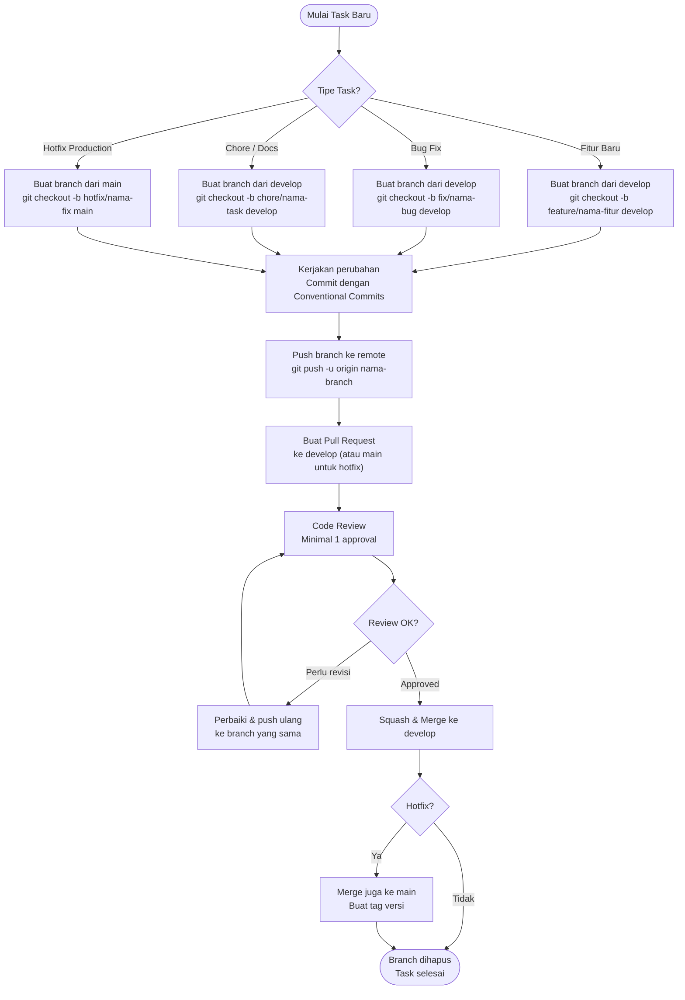

[↩ Kembali ke Beranda](../README.md)

# Panduan Kontribusi — JDIH BNPB

> Dokumen ini adalah **kontrak kerja tim**. Semua kontributor — baik developer internal BNPB maupun vendor — wajib mengikuti panduan ini. Konsistensi kode dan riwayat Git yang bersih adalah tanggung jawab bersama.

---

## Daftar Isi

- [Prasyarat Lingkungan](#prasyarat-lingkungan)
- [Git Branching Strategy](#git-branching-strategy)
  - [Struktur Branch](#struktur-branch)
  - [Alur Kerja Branch](#alur-kerja-branch)
  - [Aturan Penamaan Branch](#aturan-penamaan-branch)
- [Conventional Commits](#conventional-commits)
  - [Format Pesan Commit](#format-pesan-commit)
  - [Tipe Commit yang Valid](#tipe-commit-yang-valid)
  - [Contoh Commit yang Baik dan Buruk](#contoh-commit-yang-baik-dan-buruk)
  - [Breaking Changes](#breaking-changes)
- [Code Style & Quality](#code-style--quality)
  - [PHP — Laravel Pint](#php--laravel-pint)
  - [Blade & Livewire](#blade--livewire)
  - [JavaScript](#javascript)
  - [EditorConfig](#editorconfig)
- [Pull Request Workflow](#pull-request-workflow)
  - [Checklist Sebelum PR](#checklist-sebelum-pr)
  - [Template PR](#template-pr)
  - [Review Guidelines](#review-guidelines)
- [Standar Penulisan Kode](#standar-penulisan-kode)
  - [PHP & Laravel](#php--laravel)
  - [Database & Migration](#database--migration)
  - [Keamanan](#keamanan)

---

## Prasyarat Lingkungan

Sebelum mulai berkontribusi, pastikan tools berikut sudah terpasang dan dikonfigurasi:

| Tool | Versi Minimum | Tujuan |
|---|---|---|
| PHP | `8.2` | Runtime utama |
| Composer | `2.x` | Dependency manager PHP |
| Node.js | `20.x` | Build frontend (Vite) |
| npm | `10.x` | Package manager JS |
| MySQL | `8.0` | Database |
| Git | `2.40+` | Version control |
| VS Code / PhpStorm | Latest | Editor (disarankan) |

**Setup awal** (jika belum):

```bash
# Clone dan setup
git clone https://github.com/bnpb/jdih-bnpb.git
cd jdih-bnpb
composer install
npm install
cp .env.example .env
php artisan key:generate
php artisan migrate --seed
php artisan shield:generate --panel=webmin --all
php artisan storage:link
npm run build
```

---

## Git Branching Strategy

Project ini menggunakan strategi **GitHub Flow** yang disederhanakan — cocok untuk tim kecil dengan deployment yang sering.

### Struktur Branch



### Penjelasan Branch Utama

| Branch | Proteksi | Deskripsi |
|---|---|---|
| `main` | 🔒 Protected | Kode production. Hanya menerima merge dari `release/*` atau `hotfix/*`. **Tidak boleh push langsung.** |
| `develop` | 🔒 Protected | Branch integrasi. Semua fitur selesai di-merge ke sini sebelum release. |
| `feature/*` | Bebas | Branch untuk pengembangan fitur baru. Dibuat dari `develop`. |
| `fix/*` | Bebas | Branch untuk perbaikan bug non-kritis. Dibuat dari `develop`. |
| `hotfix/*` | Bebas | Branch untuk perbaikan bug kritis di production. Dibuat dari `main`. |
| `release/*` | Bebas | Branch persiapan rilis. Dibuat dari `develop`, di-merge ke `main` dan `develop`. |
| `chore/*` | Bebas | Branch untuk pekerjaan non-fitur (update dependency, refactor, docs). |

### Alur Kerja Branch



### Aturan Penamaan Branch

Format: `{tipe}/{deskripsi-singkat-kebab-case}`

```bash
# ✅ BENAR
feature/google-analytics-dashboard
feature/dokumen-filter-bidang-hukum
fix/visitor-counter-duplicate
fix/slug-regeneration-on-update
hotfix/download-403-error
chore/update-filament-v4
chore/add-performance-indexes
release/v1.3.0

# ❌ SALAH
Feature/GoogleAnalytics        # Huruf kapital
fix_visitor_bug                # Underscore, bukan kebab-case
my-branch                      # Tidak ada tipe prefix
update                         # Terlalu generik
```

---

## Conventional Commits

Semua pesan commit **wajib** mengikuti standar [Conventional Commits v1.0.0](https://www.conventionalcommits.org/). Ini memungkinkan auto-generate changelog dan semantic versioning.

### Format Pesan Commit

```
<type>(<scope>): <description>

[optional body]

[optional footer(s)]
```

- **`type`** — wajib, lihat tabel di bawah
- **`scope`** — opsional, konteks perubahan dalam tanda kurung
- **`description`** — wajib, kalimat imperatif, huruf kecil, tanpa titik di akhir, maks 72 karakter
- **`body`** — opsional, penjelasan *mengapa* (bukan *apa*), dipisah satu baris kosong
- **`footer`** — opsional, untuk breaking changes atau referensi issue

### Tipe Commit yang Valid

| Tipe | Kapan Digunakan | Contoh Scope |
|---|---|---|
| `feat` | Menambah fitur baru yang terlihat pengguna | `dokumen`, `berita`, `api`, `panel` |
| `fix` | Memperbaiki bug | `visitor`, `download`, `slug`, `auth` |
| `docs` | Perubahan dokumentasi saja | `readme`, `api`, `contributing` |
| `style` | Perubahan format kode (spasi, titik koma) tanpa mengubah logika | `pint`, `blade` |
| `refactor` | Restrukturisasi kode tanpa menambah fitur atau memperbaiki bug | `dokumen-model`, `controller` |
| `perf` | Peningkatan performa | `query`, `index`, `cache` |
| `test` | Menambah atau memperbaiki test | `unit`, `feature` |
| `chore` | Pekerjaan maintenance (update dependency, konfigurasi build) | `composer`, `npm`, `ci` |
| `ci` | Perubahan konfigurasi CI/CD | `github-actions`, `pipeline` |
| `revert` | Membatalkan commit sebelumnya | — |
| `security` | Perbaikan celah keamanan | `middleware`, `auth`, `upload` |

### Contoh Commit yang Baik dan Buruk

```bash
# ✅ BENAR — feat dengan scope dan deskripsi jelas
git commit -m "feat(dokumen): add filter by bidang hukum in livewire component"

# ✅ BENAR — fix dengan body yang menjelaskan root cause
git commit -m "fix(slug): prevent duplicate slug on document update

Slug was not being regenerated when nomor or tahun changed
because the dirty check was missing ref_jenis_dokumen_id.
Added all three fields to the slugTriggers array in boot()."

# ✅ BENAR — perf dengan referensi migration
git commit -m "perf(query): add composite index on status and tahun columns

Resolves N+1 query on DokumenList livewire component.
Migration: 2026_04_27_000001_add_performance_indexes"

# ✅ BENAR — chore tanpa scope
git commit -m "chore: update filament to v4.1.2"

# ✅ BENAR — security
git commit -m "security(middleware): add CIDR support to IP whitelist validation"

# ❌ SALAH — tidak ada tipe
git commit -m "update dokumen controller"

# ❌ SALAH — terlalu generik
git commit -m "fix: bug fix"

# ❌ SALAH — huruf kapital di description
git commit -m "feat: Add Google Analytics Dashboard"

# ❌ SALAH — titik di akhir
git commit -m "fix(visitor): prevent duplicate daily records."

# ❌ SALAH — past tense
git commit -m "feat(api): added rate limiting to metadata endpoint"

# ❌ SALAH — WIP commit masuk ke PR
git commit -m "WIP"
git commit -m "asdfgh"
git commit -m "coba lagi"
```

### Breaking Changes

Jika perubahan **tidak backward-compatible** (mengubah API, skema database, atau perilaku yang sudah ada), tambahkan `BREAKING CHANGE` di footer:

```bash
git commit -m "feat(api): change metadata response format to paginated

BREAKING CHANGE: /metadata/api now returns paginated response
with 'data', 'links', and 'meta' keys instead of flat array.
External systems must update their integration accordingly."
```

Atau gunakan `!` setelah tipe untuk menandai breaking change:

```bash
git commit -m "feat(api)!: change metadata response to paginated format"
```

---

## Code Style & Quality

### PHP — Laravel Pint

Project menggunakan **[Laravel Pint](https://laravel.com/docs/pint)** (wrapper PHP-CS-Fixer) dengan preset `laravel` sebagai standar default.

```bash
# Cek style tanpa mengubah file
./vendor/bin/pint --test

# Fix semua file
./vendor/bin/pint

# Fix file tertentu saja
./vendor/bin/pint app/Models/DokumenHukum.php

# Fix direktori tertentu
./vendor/bin/pint app/Http/Controllers/
```

**Aturan utama yang diterapkan (preset `laravel`):**

| Aturan | Contoh |
|---|---|
| Indentasi 4 spasi | Tidak boleh tab |
| Single quotes untuk string | `'string'` bukan `"string"` (kecuali ada interpolasi) |
| Trailing comma di array multi-baris | `['a', 'b',]` |
| Blank line setelah `namespace` | Wajib |
| Import diurutkan alphabetically | `use A; use B; use C;` |
| Tidak ada `?>` di akhir file PHP | Wajib |
| Spasi di sekitar operator | `$a = $b + $c` |
| Return type declaration | `function foo(): string` |

**Wajib dijalankan sebelum setiap commit:**

```bash
./vendor/bin/pint
```

> Jika menggunakan VS Code, install extension **[Laravel Pint](https://marketplace.visualstudio.com/items?itemName=open-southeners.laravel-pint)** untuk format otomatis saat save.

### Blade & Livewire

Tidak ada linter otomatis untuk Blade, namun ikuti konvensi berikut:

```blade
{{-- ✅ BENAR: Komentar Blade, bukan HTML comment --}}
{{-- Ini tidak akan muncul di source HTML --}}

{{-- ✅ BENAR: Escape output selalu --}}
{{ $dokumen->judul }}

{{-- ❌ SALAH: Jangan gunakan unescaped output kecuali benar-benar perlu --}}
{!! $dokumen->judul !!}

{{-- ✅ BENAR: Gunakan @php untuk logika singkat --}}
@php
    $label = $dokumen->status === 'BERLAKU' ? 'Aktif' : 'Tidak Aktif';
@endphp

{{-- ❌ SALAH: Jangan taruh logika bisnis kompleks di Blade --}}
{{-- Pindahkan ke Controller, Model accessor, atau Livewire component --}}
```

**Livewire component:**
- Satu komponen = satu tanggung jawab
- Gunakan `wire:key` pada setiap item dalam loop
- Hindari `$this->emit()` yang berlebihan — gunakan Livewire events dengan bijak
- Properti publik yang tidak perlu di-track oleh Livewire, tandai dengan `#[Locked]`

### JavaScript

Project menggunakan JavaScript vanilla di dalam `<script>` tag pada Blade views (tidak ada bundler JS terpisah untuk custom scripts). Ikuti konvensi:

```javascript
// ✅ BENAR: Gunakan var/const/let yang tepat
const PALETTE = ['#3b82f6', '#8b5cf6'];
let chartInstance = null;

// ✅ BENAR: IIFE untuk menghindari polusi global scope
(function () {
    function initCharts() { /* ... */ }
    document.addEventListener('DOMContentLoaded', initCharts);
})();

// ✅ BENAR: Prefix window.__ untuk variabel global yang disengaja
window.__gaCharts = window.__gaCharts || {};

// ❌ SALAH: Variabel global tanpa namespace
var charts = {};
```

### EditorConfig

File `.editorconfig` sudah dikonfigurasi. Pastikan editor Anda mendukungnya:

```ini
# .editorconfig (sudah ada di root project)
[*]
charset = utf-8
end_of_line = lf          # Line ending UNIX, bukan Windows CRLF
indent_size = 4
indent_style = space       # Spasi, bukan tab
insert_final_newline = true
trim_trailing_whitespace = true

[*.md]
trim_trailing_whitespace = false  # Markdown butuh trailing space untuk line break

[*.{yml,yaml}]
indent_size = 2            # YAML pakai 2 spasi
```

> **Windows developer:** Pastikan Git dikonfigurasi dengan `git config --global core.autocrlf false` agar tidak mengubah line ending ke CRLF.

---

## Pull Request Workflow

### Checklist Sebelum PR

Sebelum membuka Pull Request, pastikan semua item berikut sudah terpenuhi:

```
[ ] Branch dibuat dari develop (atau main untuk hotfix)
[ ] Nama branch mengikuti konvensi {tipe}/{deskripsi-kebab-case}
[ ] Semua commit mengikuti Conventional Commits
[ ] Tidak ada commit "WIP", "fix typo", "coba lagi" yang belum di-squash
[ ] php artisan pint sudah dijalankan dan tidak ada error
[ ] php artisan test sudah dijalankan (jika ada test)
[ ] php artisan migrate sudah dijalankan untuk migration baru
[ ] Tidak ada file .env, credentials, atau secret yang ter-commit
[ ] storage/app/private/*.json tidak ter-commit (sudah di .gitignore)
[ ] Tidak ada dd(), dump(), var_dump(), atau console.log() yang tertinggal
[ ] Perubahan sudah ditest secara manual di browser
[ ] Dokumentasi diupdate jika ada perubahan API atau fitur besar
```

### Template PR

Gunakan template berikut saat membuat Pull Request:

```markdown
## Ringkasan

<!-- Jelaskan apa yang diubah dan mengapa dalam 2-3 kalimat -->

## Tipe Perubahan

- [ ] Bug fix (perubahan non-breaking yang memperbaiki issue)
- [ ] Fitur baru (perubahan non-breaking yang menambah fungsionalitas)
- [ ] Breaking change (fix atau fitur yang menyebabkan fungsionalitas lama tidak bekerja)
- [ ] Perubahan dokumentasi
- [ ] Refactor / peningkatan performa
- [ ] Chore (update dependency, konfigurasi)

## Perubahan yang Dilakukan

<!-- List perubahan spesifik -->
- 
- 
- 

## Screenshot (jika ada perubahan UI)

<!-- Tambahkan screenshot before/after jika relevan -->

## Cara Test

<!-- Langkah-langkah untuk memverifikasi perubahan ini -->
1. 
2. 
3. 

## Checklist

- [ ] Kode mengikuti style guide project (Pint sudah dijalankan)
- [ ] Tidak ada debug statement yang tertinggal
- [ ] Migration baru sudah ditest dengan `php artisan migrate:fresh`
- [ ] Tidak ada file sensitif yang ter-commit
```

### Review Guidelines

**Untuk Reviewer:**

- Berikan feedback yang konstruktif dan spesifik — tunjukkan baris kode yang dimaksud
- Bedakan antara **blocking** (harus diperbaiki) dan **suggestion** (opsional)
- Gunakan prefix: `[blocking]`, `[suggestion]`, `[question]`, `[nit]`
- Approve hanya jika semua blocking issue sudah diselesaikan
- Jangan merge PR sendiri kecuali hotfix darurat

```
# Contoh komentar review yang baik:

[blocking] Method `isSafePublicStoragePath()` tidak menangani
path dengan backslash di Windows. Tambahkan normalisasi
`str_replace('\\', '/', $path)` sebelum validasi.

[suggestion] Pertimbangkan menggunakan `Cache::tags()` agar
cache GA bisa di-invalidate per tag tanpa flush semua cache.

[nit] Typo: "Pengundagan" seharusnya "Pengundangan" di baris 42.

[question] Apakah `download_count` perlu di-increment juga
untuk unduhan abstrak? Saat ini hanya lampiran yang di-track.
```

**Untuk Author:**

- Respond setiap komentar — baik dengan perubahan kode atau penjelasan mengapa tidak diubah
- Jangan force-push ke branch yang sudah di-review (kecuali diminta)
- Tandai komentar sebagai "resolved" setelah diperbaiki

---

## Standar Penulisan Kode

### PHP & Laravel

**Controller — tetap tipis, delegasikan ke Model/Service:**

```php
// ✅ BENAR: Controller hanya orkestrasi
public function show(ShowDokumenRequest $request, $tipeDok, $slug)
{
    $dokumen = DokumenHukum::with(['jenisDokumen', 'bidangHukumRef', 'subjekRef'])
        ->findBySlug($tipeDok, $slug)
        ->firstOrFail();

    DB::table('dokumen_hukums')->where('id', $dokumen->id)->increment('view_count');

    return view('dokumen.detail', [
        'dokumen'  => $dokumen,
        'metadata' => $dokumen->metadata,
        'seo'      => SeoHelper::meta($dokumen),
    ]);
}

// ❌ SALAH: Logika bisnis di controller
public function show($slug)
{
    $dokumen = DokumenHukum::where('slug', $slug)->first();
    $singkatan = $dokumen->jenisDokumen->singkatan ?? '-';
    $bidang = $dokumen->bidangHukumRef->nama ?? '-';
    // ... 50 baris logika lagi
}
```

**Model — gunakan accessor, scope, dan observer:**

```php
// ✅ BENAR: Accessor untuk computed property
public function getFileTersediaAttribute(): bool
{
    return $this->download_allowed
        && $this->lampiran_exists
        && ($this->lampiran_size['kb'] ?? 0) > 0;
}

// ✅ BENAR: Scope untuk query yang sering dipakai
public function scopeLatestPeraturan(Builder $query, int $limit = 4)
{
    return $query
        ->where('tipeDok', 'Peraturan')
        ->where('status', 'BERLAKU')
        ->orderByDesc('tglPengundangan')
        ->limit($limit);
}

// ✅ BENAR: Increment tanpa trigger updated_at
DB::table('dokumen_hukums')->where('id', $id)->increment('view_count');

// ❌ SALAH: Ini akan trigger updated_at dan semua observer
$dokumen->increment('view_count');
```

**Form Request — validasi di sini, bukan di controller:**

```php
// ✅ BENAR: Semua validasi di Form Request
class ShowDokumenRequest extends FormRequest
{
    public function rules(): array
    {
        return [
            'tipeDok' => ['required', 'in:Peraturan,Monografi,Artikel,Putusan'],
        ];
    }
}
```

**Hindari N+1 Query — selalu eager load relasi:**

```php
// ✅ BENAR
DokumenHukum::with(['jenisDokumen', 'bidangHukumRef', 'subjekRef'])->get();

// ❌ SALAH — N+1 query
$dokumens = DokumenHukum::all();
foreach ($dokumens as $d) {
    echo $d->jenisDokumen->nama; // Query baru setiap iterasi!
}
```

### Database & Migration

```php
// ✅ BENAR: Migration yang reversible
public function up(): void
{
    Schema::table('dokumen_hukums', function (Blueprint $table) {
        $table->string('penandatangan', 255)->default('-')->after('nomorIndukBuku');
    });
}

public function down(): void
{
    Schema::table('dokumen_hukums', function (Blueprint $table) {
        $table->dropColumn('penandatangan');
    });
}

// ❌ SALAH: Migration tanpa down() yang benar
public function down(): void
{
    // kosong atau Schema::dropIfExists('dokumen_hukums') — berbahaya!
}
```

**Aturan migration:**
- Selalu isi method `down()` dengan operasi yang benar-benar membalik `up()`
- Gunakan `nullable()` untuk kolom baru di tabel yang sudah berisi data
- Tambahkan indeks untuk kolom yang sering digunakan di `WHERE`, `ORDER BY`, atau `JOIN`
- Gunakan `utf8mb4` charset dan `utf8mb4_unicode_ci` collation untuk tabel baru
- Jangan pernah edit migration yang sudah di-commit dan di-push — buat migration baru

### Keamanan

**Wajib diikuti tanpa pengecualian:**

```php
// ✅ BENAR: Selalu escape output di Blade
{{ $dokumen->judul }}

// ❌ SALAH: Unescaped output membuka XSS
{!! $dokumen->judul !!}
// Hanya boleh untuk konten HTML yang sudah disanitasi (misal: RichEditor output)

// ✅ BENAR: Validasi path file sebelum serve
abort_unless($this->isSafePublicStoragePath($dokumen->lampiran), 404);

// ✅ BENAR: Gunakan Gate untuk otorisasi
Gate::authorize('download', $dokumen);

// ❌ SALAH: Otorisasi manual tanpa Gate/Policy
if ($dokumen->status !== 'BERLAKU') {
    abort(403); // Tidak konsisten, tidak testable
}

// ✅ BENAR: Jangan log password atau data sensitif
Log::info('Login attempt', ['email' => $email, 'ip' => $ip]);

// ❌ SALAH
Log::info('Login', ['password' => $password]); // JANGAN PERNAH

// ✅ BENAR: Credentials di .env, bukan hardcoded
$credentialsPath = config('services.google_analytics.credentials_path');

// ❌ SALAH
$credentialsPath = '/var/www/html/storage/app/private/ga.json'; // Hardcoded path
```

**File upload — selalu validasi tipe dan ukuran:**

```php
// ✅ BENAR: Validasi ketat di Filament FileUpload
FileUpload::make('lampiran')
    ->disk('public')
    ->directory('file')
    ->acceptedFileTypes(['application/pdf', 'image/jpeg', 'image/png'])
    ->maxSize(25600) // 25MB dalam KB
    ->preserveFilenames()
```

**Jangan commit secret apapun ke Git:**

```bash
# File-file ini sudah di .gitignore — JANGAN pernah force add
.env
storage/app/private/*.json   # Google Analytics credentials
auth.json                    # Composer auth
```
