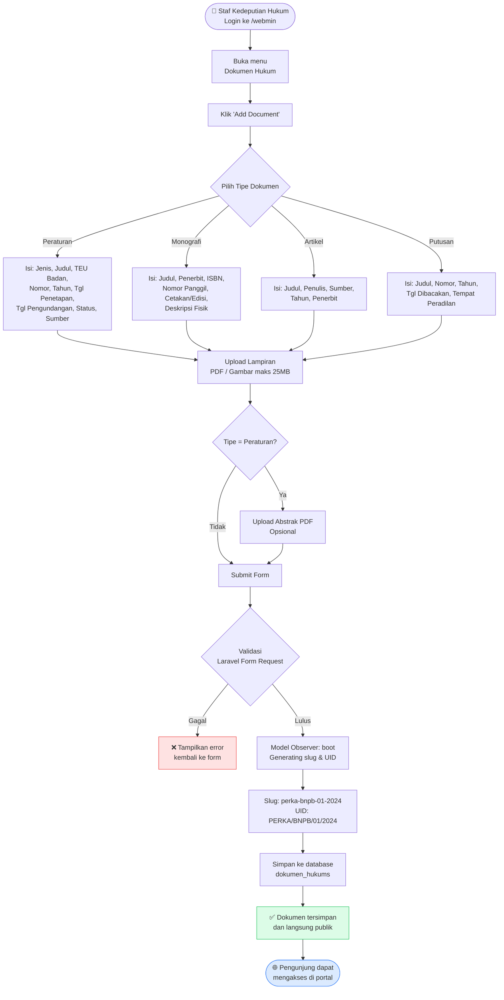
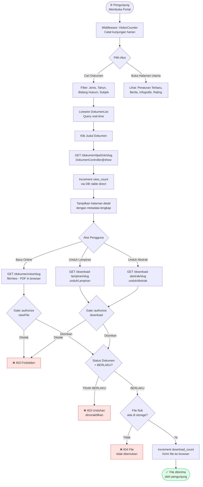
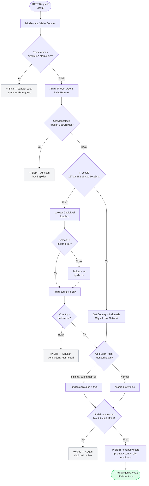
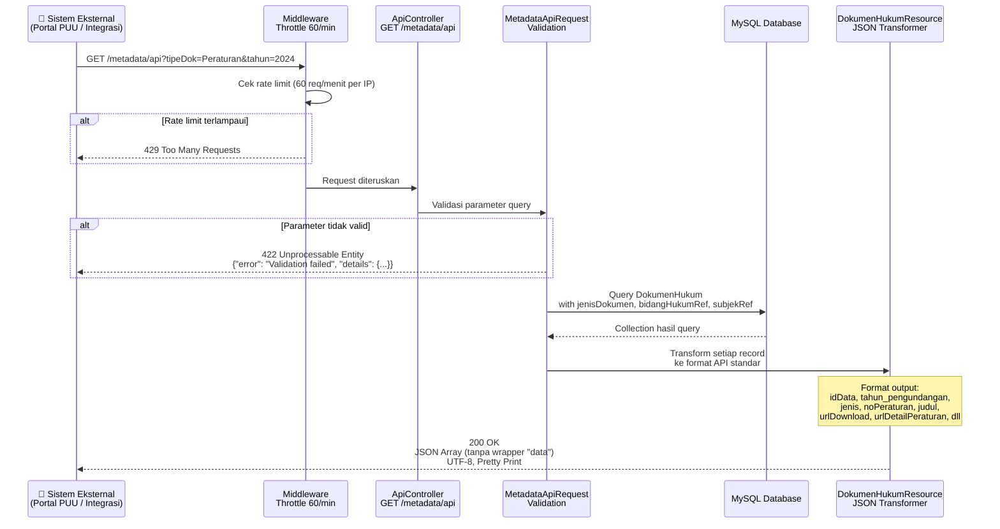

[↩ Kembali ke Beranda](../README.md)

# Spesifikasi Produk — JDIH BNPB

> **Dokumen ini ditujukan untuk:** Product Owner, Manajer Proyek, Analis Bisnis, dan Developer baru yang perlu memahami *apa* yang dilakukan sistem ini dan *mengapa*, tanpa harus membaca kode.

---

## Daftar Isi

- [Ringkasan Eksekutif](#ringkasan-eksekutif)
- [Pengguna & Pemangku Kepentingan](#pengguna--pemangku-kepentingan)
- [Matriks RBAC (Role-Based Access Control)](#matriks-rbac-role-based-access-control)
- [Alur Bisnis Utama](#alur-bisnis-utama)
  - [Alur 1: Publikasi Dokumen Hukum](#alur-1-publikasi-dokumen-hukum)
  - [Alur 2: Akses Publik & Unduhan Dokumen](#alur-2-akses-publik--unduhan-dokumen)
  - [Alur 3: Pencatatan Pengunjung](#alur-3-pencatatan-pengunjung)
  - [Alur 4: Sinkronisasi Data via API](#alur-4-sinkronisasi-data-via-api)
- [Katalog Fitur Lengkap](#katalog-fitur-lengkap)
- [Aturan Bisnis Kritis](#aturan-bisnis-kritis)
- [Glosarium](#glosarium)

---

## Ringkasan Eksekutif

**JDIH BNPB** adalah portal web resmi untuk pengelolaan dan publikasi produk hukum Badan Nasional Penanggulangan Bencana. Sistem ini menjawab dua kebutuhan utama:

1. **Kebutuhan Publik** — Masyarakat, peneliti, dan instansi lain membutuhkan akses mudah, cepat, dan terstruktur terhadap peraturan perundang-undangan yang diterbitkan BNPB. Sebelumnya, dokumen tersebar dan sulit ditemukan.

2. **Kebutuhan Internal** — Tim Kedeputian Hukum BNPB membutuhkan alat manajemen konten yang efisien, dengan kontrol akses berbasis peran, audit trail, dan kemampuan sinkronisasi data ke sistem Pusat Peraturan Perundang-undangan (PUU) nasional.

**Nilai utama yang dihasilkan:**
- Satu sumber kebenaran (*single source of truth*) untuk seluruh produk hukum BNPB
- Transparansi dan akuntabilitas melalui akses publik tanpa hambatan
- Efisiensi operasional melalui otomatisasi slug, UID dokumen, dan metadata
- Interoperabilitas dengan sistem hukum nasional melalui API terbuka

---

## Pengguna & Pemangku Kepentingan

| Kelompok | Tipe | Kebutuhan Utama |
|---|---|---|
| **Masyarakat Umum** | Pengguna Akhir (Publik) | Mencari, membaca, dan mengunduh dokumen hukum BNPB |
| **Peneliti & Akademisi** | Pengguna Akhir (Publik) | Akses metadata terstruktur via API untuk riset |
| **Instansi Pemerintah Lain** | Pengguna Akhir (Publik) | Sinkronisasi data ke sistem PUU nasional |
| **Biro Hukum** | Administrator (Internal) | Input, edit, dan publikasi dokumen hukum |
| **Editor Konten** | Administrator (Internal) | Kelola berita, infografis, dan halaman profil |
| **IT Administrator** | Administrator (Internal) | Kelola pengguna, role, dan monitoring sistem |
| **Pimpinan BNPB** | Pemangku Kepentingan | Laporan statistik dan monitoring kinerja portal |

---

## Matriks RBAC (Role-Based Access Control)

Sistem otorisasi dibangun di atas **Spatie Laravel Permission** yang dikelola melalui **Filament Shield**. Setiap permission di-generate otomatis per resource dengan format `{aksi}_{resource}`.

### Definisi Role

| Role | Deskripsi | Dibuat Oleh |
|---|---|---|
| `super_admin` | Akses penuh tanpa batasan ke seluruh sistem | `php artisan shield:super-admin` |
| `admin` | Akses penuh ke konten, terbatas di user management | Manual via panel |
| `editor` | Hanya dapat membuat dan mengedit konten, tidak dapat menghapus | Manual via panel |
| `viewer` | Hanya dapat melihat data di panel, tidak dapat mengubah | Manual via panel |

### Matriks Akses per Fitur

Keterangan: ✅ = Akses Penuh | 📝 = Buat & Edit | 👁 = Lihat Saja | ❌ = Tidak Ada Akses

| Fitur / Resource | `super_admin` | `admin` | `editor` | `viewer` |
|---|:---:|:---:|:---:|:---:|
| **Dokumen Hukum** — Lihat | ✅ | ✅ | ✅ | 👁 |
| **Dokumen Hukum** — Buat & Edit | ✅ | ✅ | 📝 | ❌ |
| **Dokumen Hukum** — Hapus | ✅ | ✅ | ❌ | ❌ |
| **Berita** — Lihat | ✅ | ✅ | ✅ | 👁 |
| **Berita** — Buat & Edit | ✅ | ✅ | 📝 | ❌ |
| **Berita** — Hapus | ✅ | ✅ | ❌ | ❌ |
| **Infografis** — Buat & Edit | ✅ | ✅ | 📝 | ❌ |
| **Profil Page** — Buat & Edit | ✅ | ✅ | 📝 | ❌ |
| **FAQ** — Buat & Edit | ✅ | ✅ | 📝 | ❌ |
| **Metadata Referensi** (Jenis, Bidang, Subjek) | ✅ | ✅ | ❌ | ❌ |
| **User Management** — Lihat | ✅ | ✅ | ❌ | ❌ |
| **User Management** — Buat & Edit | ✅ | ❌ | ❌ | ❌ |
| **Role Management** | ✅ | ❌ | ❌ | ❌ |
| **Visitor Logs** — Lihat | ✅ | ✅ | ❌ | 👁 |
| **Visitor Logs** — Hapus | ✅ | ✅ | ❌ | ❌ |
| **Google Analytics Dashboard** | ✅ | ✅ | ❌ | ❌ |
| **Application Health Check** | ✅ | ❌ | ❌ | ❌ |
| **Edit Profil Sendiri** | ✅ | ✅ | ✅ | ✅ |

> **Catatan Implementasi:** `super_admin` di-bypass dari semua pengecekan permission melalui `canAccessPanel()` di `App\Models\User`. Role lain diperiksa via Filament Shield secara granular per resource.

---

## Alur Bisnis Utama

### Alur 1: Publikasi Dokumen Hukum

Alur ini menggambarkan proses dari input dokumen oleh staf hingga dokumen tersedia untuk publik.

---

### Alur 2: Akses Publik & Unduhan Dokumen

Alur ini menggambarkan perjalanan pengunjung publik dari pencarian hingga mengunduh dokumen.

---

### Alur 3: Pencatatan Pengunjung

Alur ini menggambarkan bagaimana sistem mencatat dan memfilter pengunjung secara otomatis di background.

---

### Alur 4: Sinkronisasi Data via API

Alur ini menggambarkan bagaimana sistem eksternal (seperti portal PUU nasional) mengambil data dari JDIH BNPB.

---

## Katalog Fitur Lengkap

### Portal Publik

| Fitur | Route | Deskripsi Teknis |
|---|---|---|
| Halaman Utama | `GET /` | Statistik dokumen, peraturan terbaru, berita, infografis, rating widget |
| Daftar Dokumen | `GET /dokumen/{tipeDok?}` | Filter multi-dimensi via Livewire, lazy loading |
| Detail Dokumen | `GET /dokumen/{tipeDok}/{slug}` | Metadata lengkap, increment `view_count` |
| Pratinjau PDF | `GET /dokumen/view/{slug}` | Stream file langsung ke browser, Gate check |
| Unduh Lampiran | `GET /download-lampiran/{slug}` | Gate check + status check + increment `download_count` |
| Unduh Abstrak | `GET /download-abstrak/{slug}` | Hanya untuk tipe Peraturan |
| Daftar Berita | `GET /berita` | Berita aktif (`status = 1`) |
| Detail Berita | `GET /berita/{slug}` | Increment `view_count` |
| Daftar Infografis | `GET /infografis` | Infografis aktif, maks 6 item di homepage |
| Halaman Profil | `GET /profil/{slug}` | Konten dinamis dari `profil_pages`, slug `faq` khusus |
| Rating Website | `POST /` | Simpan rating 1-5 bintang |
| API Rating | `GET /api/rating-summary` | JSON distribusi & rata-rata rating |

### Panel Administrasi (`/webmin`)

| Fitur | Grup Navigasi | Deskripsi |
|---|---|---|
| Manajemen Dokumen Hukum | Main Menu | CRUD + upload file + auto-slug + auto-UID |
| Manajemen Berita | Main Menu | CRUD + Rich Editor + upload gambar + toggle status |
| Manajemen Infografis | Main Menu | CRUD + upload gambar + toggle status |
| Manajemen FAQ | Main Menu | CRUD + sort order |
| Profil Page | Features | CMS halaman statis (Visi Misi, Struktur Org, dll) |
| Visitor Logs | Features | Log pengunjung real-time, filter negara & suspicious |
| Application Health | Features | Status DB, cache, storage, queue |
| Jenis Dokumen | Metadata Referensi | Master data jenis + singkatan |
| Bidang Hukum | Metadata Referensi | Master data bidang hukum |
| Subjek Hukum | Metadata Referensi | Master data subjek + kategori |
| User Management | User Management | CRUD user + assign role |
| Role Management | User Management | CRUD role + assign permission granular |
| Google Analytics | Systems | Dashboard GA4: tren, traffic, perangkat, negara |

---

## Aturan Bisnis Kritis

Berikut adalah aturan-aturan yang **tidak boleh dilanggar** dalam pengembangan fitur baru:

**BR-01: Unduhan hanya untuk dokumen BERLAKU**
> Dokumen dengan status `TIDAK BERLAKU` tidak dapat diunduh. Accessor `download_allowed` di model `DokumenHukum` mengembalikan `false` jika status bukan `BERLAKU`. Controller memeriksa ini sebelum mengirim file.

**BR-02: Slug dan UID di-generate otomatis, tidak boleh diinput manual**
> Slug dan `document_uid` di-generate oleh `Model::boot()` saat `creating` dan `updating`. Format UID: `{SINGKATAN}/{LEMBAGA}/{NOMOR}/{TAHUN}` (contoh: `PERKA/BNPB/01/2024`). Jika terjadi duplikasi, suffix angka ditambahkan otomatis.

**BR-03: File lama dihapus otomatis saat diganti**
> Saat field `lampiran` atau `abstrak` diubah, file lama di storage dihapus oleh `Model::boot()` pada event `updating`. Saat record dihapus, semua file terkait juga dihapus (`deleted` event).

**BR-04: Visitor hanya dicatat sekali per hari per IP**
> Middleware `VisitorCounter` memeriksa keberadaan record dengan IP yang sama pada hari yang sama sebelum insert. Ini mencegah inflasi statistik.

**BR-05: Pengunjung luar negeri tidak dicatat**
> Sistem hanya mencatat pengunjung dari Indonesia (atau IP lokal). Pengunjung dari negara lain di-skip setelah geolokasi terdeteksi.

**BR-06: Path file harus aman (path traversal prevention)**
> Method `isSafePublicStoragePath()` di `DokumenController` memvalidasi bahwa path tidak dimulai dengan `/` dan tidak mengandung `../`. Ini mencegah serangan path traversal.

**BR-07: API metadata tidak memerlukan autentikasi, tapi dibatasi throttle**
> Endpoint `/metadata/api` bersifat publik untuk mendukung interoperabilitas, namun dibatasi 60 request per menit per IP untuk mencegah penyalahgunaan.

**BR-08: Akses panel admin dibatasi IP whitelist**
> Middleware `RestrictIpMiddleware` diterapkan pada semua route `/webmin/*`. Hanya IP yang terdaftar di `config/whitelist-ip.php` yang dapat mengakses panel. Localhost selalu diizinkan.

---

## Glosarium

| Istilah | Kepanjangan / Definisi |
|---|---|
| **JDIH** | Jaringan Dokumentasi dan Informasi Hukum — sistem nasional pengelolaan dokumen hukum Indonesia |
| **BNPB** | Badan Nasional Penanggulangan Bencana — lembaga pemerintah non-kementerian yang menangani penanggulangan bencana |
| **PUU** | Peraturan Perundang-Undangan — istilah umum untuk produk hukum berupa peraturan |
| **RBAC** | Role-Based Access Control — sistem otorisasi berbasis peran pengguna |
| **TEU Badan** | Tajuk Entri Utama Badan — nama lembaga/badan yang menerbitkan dokumen (standar katalogisasi perpustakaan) |
| **Tipedok** | Tipe Dokumen — klasifikasi utama dokumen: `Peraturan`, `Monografi`, `Artikel`, `Putusan` |
| **Slug** | Versi URL-friendly dari judul dokumen (contoh: `perka-bnpb-01-2024`) |
| **UID Dokumen** | Unique Identifier Dokumen — kode unik format `SINGKATAN/LEMBAGA/NOMOR/TAHUN` |
| **Lampiran** | File utama dokumen (PDF atau gambar) yang dapat diunduh publik |
| **Abstrak** | Ringkasan dokumen dalam format PDF, hanya tersedia untuk tipe Peraturan |
| **PERKA** | Peraturan Kepala — salah satu jenis peraturan yang diterbitkan Kepala BNPB |
| **GA4** | Google Analytics 4 — platform analitik web generasi terbaru dari Google |
| **Filament** | Framework admin panel untuk Laravel berbasis Livewire |
| **Shield** | Filament Shield — plugin manajemen permission granular untuk Filament |
| **Spatie Permission** | Package Laravel untuk manajemen role dan permission berbasis database |
| **Livewire** | Framework PHP untuk komponen UI reaktif tanpa JavaScript |
| **Throttle** | Pembatasan jumlah request dalam periode waktu tertentu |
| **CIDR** | Classless Inter-Domain Routing — notasi untuk mendefinisikan rentang IP (contoh: `10.220.52.0/22`) |
| **Crawler** | Bot otomatis (seperti Googlebot) yang menjelajahi web; tidak dicatat sebagai pengunjung |
